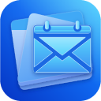
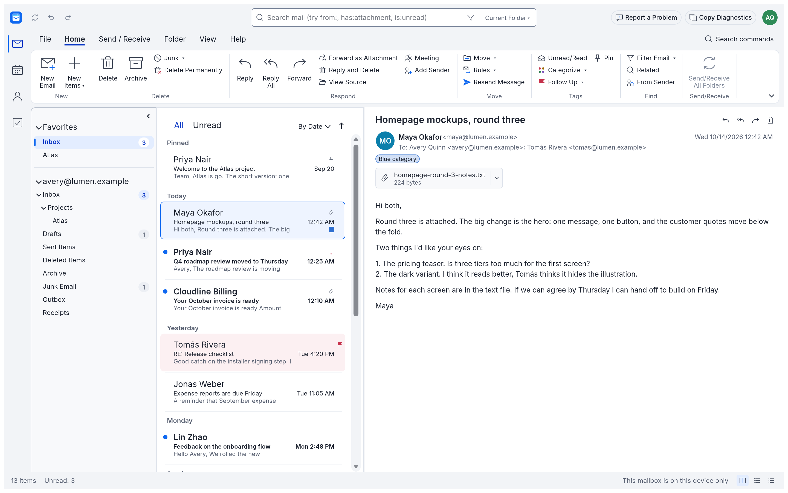
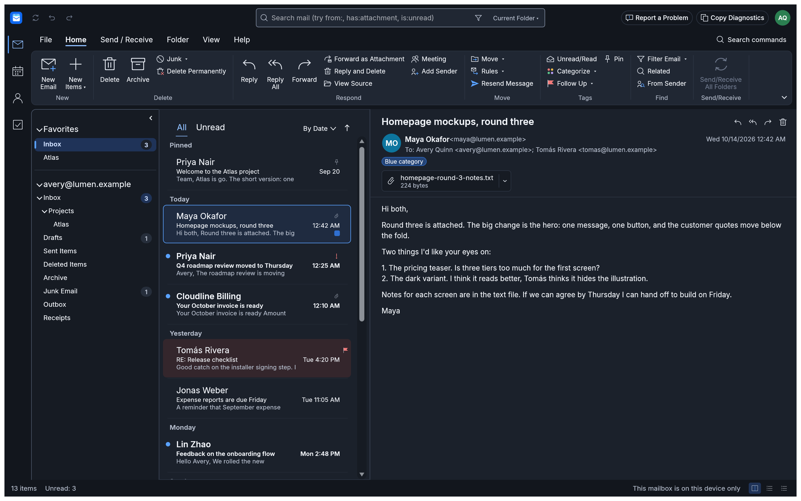
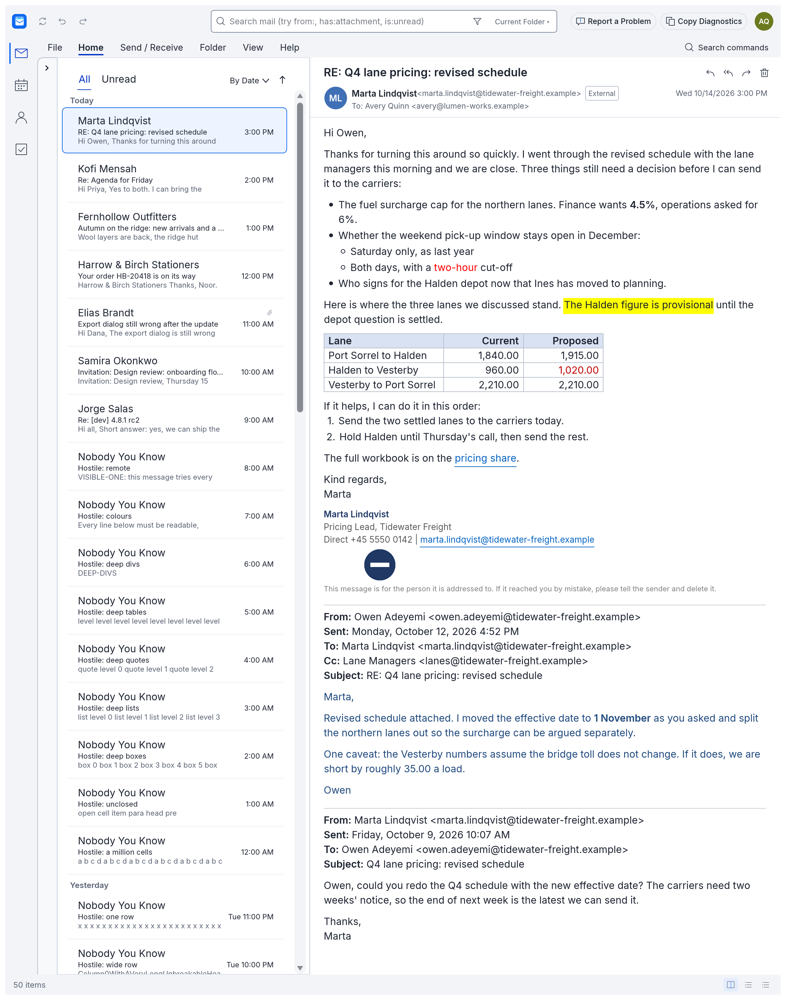
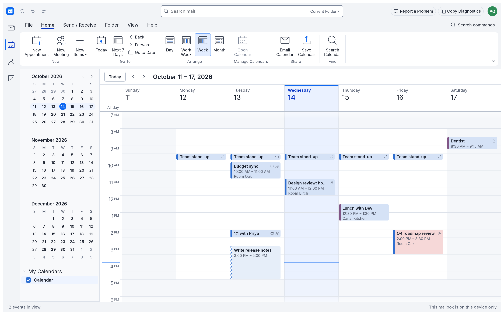
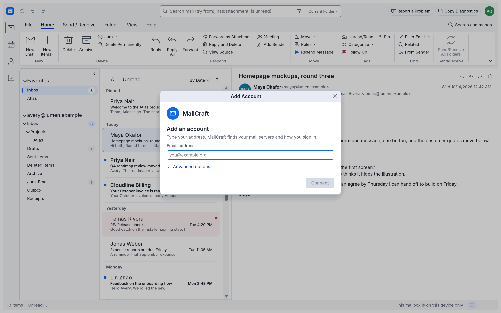
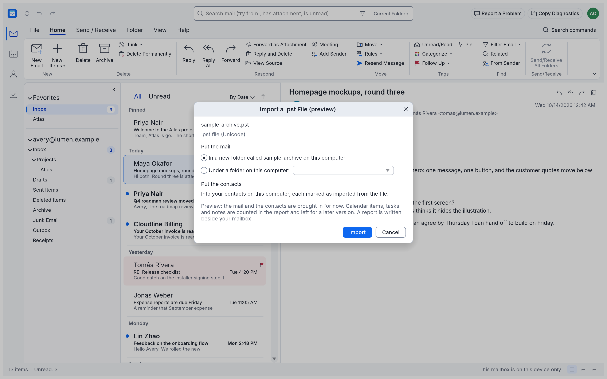

<div align="center">

# MailCraft



**An open-source mail, calendar, contacts and tasks program, written from scratch in Rust.**

MailCraft has been developed here since 12 October 2026; this repository and [mailcraft.work](https://mailcraft.work) are the project's only official homes.

<!-- Quality and security -->
[](https://github.com/UCS-Care-Group/mailcraft/actions/workflows/ci.yml)
[](https://codecov.io/gh/UCS-Care-Group/mailcraft)
[](https://github.com/UCS-Care-Group/mailcraft/actions/workflows/fuzz.yml)
[](https://sonarcloud.io/summary/new_code?id=UCS-Care-Group_mailcraft)
[](https://scorecard.dev/viewer/?uri=github.com/UCS-Care-Group/mailcraft)
[](https://www.bestpractices.dev/projects/15708)

<!-- The project -->
[](https://github.com/UCS-Care-Group/mailcraft/releases)
[](https://github.com/UCS-Care-Group/mailcraft/releases)
[](https://www.rust-lang.org)
[](#license)

<!-- Taking part -->
[](https://github.com/UCS-Care-Group/mailcraft/issues/11)

MailCraft is a clean-room reimplementation of the mail client people already know how to use: the ribbon, the folder pane, the message list with its reading pane, conversations, flags, categories, rules, a calendar with recurring meetings, people and to-dos. It is a native, GPU-rendered app (no Electron, no web view), it also runs in a browser tab through WebAssembly, and every action in it is a command that scripts and AI agents can run too.

MailCraft follows the architecture and conventions of [WordCraft](https://github.com/storytold/wordcraft) and the other Craft apps: the same layered crates, the same "everything is a command" engine, the same egui front end and design tokens, the same control channel, MCP server, tooling and packaging.

</div>

## What works today

- **Mail:** accounts, nested folders and favourites, a virtualised message list grouped by date (or sender, importance), sort, filters, conversations, pinning, a reading pane (right, bottom or off) whose text you can select and copy, flags with due dates, colour categories, importance, junk and archive, move and copy (or drag onto a folder), two-step delete with a question before anything is gone for good, Send / Receive › Work Offline, and how far back each account keeps its mail in full on this computer (older mail keeps its headers and preview and comes down again when opened), flag and delete on the row under the pointer, a click on a row's left edge to switch read and unread, a double-click to open a message in a window of its own, drag accounts into the order you want, undo and redo for all of it.
- **Search:** a query language in the search box: `budget from:ada has:attachment -draft after:2026-10-01 is:unread`, in one folder or every mailbox.
- **Writing:** new mail (also from a `mailto:` link clicked anywhere, once MailCraft is your mail program), Reply, Reply All and Forward with the original quoted, attachments, drafts, signatures, recipients suggested as you type (contacts, then the people you have exchanged mail with), Check Names, importance. Rich text as you see it (bold, italic, underline, colour, fonts, lists eight levels deep, links), sent as HTML with a plain-text part, and pasted HTML kept to what MailCraft draws; replies and forwards carry the original below as it came. Signatures with a logo, one for new mail and one for replies, made from your details or written by hand. Write several messages at once, each in a window of its own (Pop Out) or in the reading pane, with Find and Replace, Text Highlight Color, Format Painter, Insert › Symbol, Contact Card and Item, and Request a Read Receipt.
- **Rules:** conditions (from, to, subject, body, attachment, importance) and actions (move, categorise, flag, mark read, importance, delete), run on new mail or on demand.
- **Calendar:** day, work-week, week and month views; appointments and meetings with attendees; recurrence (daily, weekly on chosen days, monthly by date or by "second Tuesday", yearly; counts, end dates, skipped days); reminders that come up in a window of their own (dismiss, snooze), show-as, private; several calendars. Click or drag over empty time and type to make an appointment on the spot; drag one to move it, its edge to resize it, with Ctrl to copy it; the keyboard works the grid as it does in Outlook; double-click opens an item in a window of its own. A repeating item asks "just this one" or "the entire series". With a Microsoft 365 account, what you make, move, change or delete is on the server at once, series and every calendar of the account included, and the calendar keeps itself current; meetings send their invitations, updates and cancellations through the server, and you answer invitations from the calendar or straight from the message in the Inbox (Accept, Tentative, Decline, with what else is on at that time). Appointments and meetings open in windows of their own, with their own command bar, a recurrence dialog and Find a Time, which shows when the people you invite are free. Several calendars stand side by side or overlaid, each in its colour. How far this is from Outlook, row by row: [docs/calendar-parity.md](docs/calendar-parity.md).
- **Automatic Replies:** for a Microsoft account, File › Info › Automatic Replies turns replies on or off, only during a time range, with one reply for people inside your organisation and another for those outside it.
- **People and Tasks:** contacts with several addresses and phones, favourites and categories; to-dos with due dates, importance, and links to the flagged message they came from.
- **Servers:** IMAP and SMTP over TLS or STARTTLS, on the desktop and in the CLI; JMAP in the browser build ([docs/jmap.md](docs/jmap.md)). Mail comes down, and what you do here goes back up: read marks, flags, moves, deletions and a copy of what you send. An organisation's own Exchange Server, Grommunio or SmarterMail is added as an Exchange server account, as a preview ([#252](https://github.com/UCS-Care-Group/mailcraft/issues/252)). Account setup recognises the provider from the address (for a company's own domain, from who takes its mail); Outlook.com and Microsoft 365 sign in on Microsoft's page (OAuth 2.0), and sign-ins are remembered by the system's credential store (Windows Credential Manager, the macOS keychain, or the Secret Service of GNOME Keyring or KWallet on Linux and FreeBSD). Where an organisation lets only an administrator approve a new program, Microsoft's page says "Need admin approval" instead of signing you in: MailCraft says what to do next while that page is still open (an administrator approves it once on Microsoft's page, opened from MailCraft; anybody else copies a short message for one; then you sign in again), and nothing of you is in the address that is passed on. Send/Receive runs by itself, and mail shows as it arrives, the Inbox first. For Microsoft accounts, mail is sent through Microsoft Graph, the calendar goes both ways, contacts come down, and the folder pane's Favorites are the ones you keep in Outlook (read from the server through Microsoft Graph once you say so, never changed there; a work or school account may need its administrator's approval once). Microsoft 365 has daily-use coverage; bounded owner-authorized Windows Gmail/Workspace acceptance is documented in [the Google account guide](docs/google-accounts.md). Other interoperability limits remain in [docs/gaps.md](docs/gaps.md).
- **Files:** `.eml` and `.mbox` messages, `.ics` calendars, `.vcf` contacts, in and out; an Outlook `.pst` file's mail, contacts, calendar, tasks, notes and journal come in through File › Open & Export › Import a .pst File; the mailbox as a `.mailcraft` file with its message content in a folder beside it, saved in the background, or as one self-contained file.
- **Reading mail safely:** HTML mail is laid out with its tables, colours, lists and the pictures attached to it, readable in light and dark, without running anything in it; pictures on the web are downloaded only when you ask (for one message, always for a sender, or for all mail if you switch that on), and the request tells the sender's server nothing but the picture's address; links show where they go.
- **Look:** Outlook's layout: the rail, the folder pane, a one-row ribbon (or the classic three-row one, your choice, which folds its groups to fit a narrower window), MailCraft's own look with four accent colours and high contrast, and an icon of its own (an envelope that is also a calendar page), light and dark following the system's setting unless you choose (on Linux and the BSDs, the desktop's light or dark preference through its portal); the system's own interface font on Windows. The window comes in English and as previews in French, German, Spanish, Italian, Dutch, Romanian and Simplified Chinese (File › Options). The initial Chinese catalogue was reviewed by its contributor; the other previews await native-speaker review. Simplified Chinese is offered on desktop only until the browser build has a CJK font.
- **Installing:** every release is on the [Releases page](https://github.com/UCS-Care-Group/mailcraft/releases) with its checksums: a Windows installer (`.msi`) and portable zip for x64, x86 and ARM64; `.AppImage`, `.deb`, `.rpm`, `.flatpak` and `.tar.gz` for Linux on x86_64 and aarch64; a macOS disk image for Apple silicon and Intel; a FreeBSD tarball; a static site for the browser. The builds are not signed yet, so Windows and macOS ask before running them. One window per mailbox: starting MailCraft again, or opening a message file or a `mailto:` link, goes to the window that is already open. See [docs/releasing.md](docs/releasing.md) for what has been built and tested so far.
- **Agents:** a CLI, a JSON control channel and an MCP server expose every command; the same registry drives the ribbon and the keyboard.

## Google accounts on the desktop

Use **Send / Receive → Add Account → Sign in with Google**. App-password setup is a separate
alternative; existing accounts are never silently converted. A development build without a
Google Desktop registration explains the missing configuration and retains the fallback.

The [Gmail and Google Workspace guide](docs/google-accounts.md) covers normal setup, conversion,
reconnection, development registration overrides and common restrictions. It distinguishes
Google's application client ID/secret from your account password, and test-user access from
Workspace administrator policy. Use the primary Google address for the account; Workspace
aliases are not supported as OAuth account identities. Development registration secrets come
from the build or process environment; File → Options offers only the public client ID. The
official MailCraft registration and public Google verification remain release requirements;
this desktop work does not add browser Gmail.

## What it looks like

| | |
|---|---|
|  |  |
|  |  |
|  |  |

The pictures are of the sample mailbox (`--sample`): invented people and invented mail (the .pst page shows a synthetic test archive).

## Platforms

| | |
|---|---|
| **Desktop** | macOS (universal), Windows (x64, x86, arm64), Linux (x86_64, aarch64), FreeBSD (x86_64) |
| **Web** | any modern browser, through WebAssembly (WebGPU, or WebGL2 where that is missing) |

The browser build is the same app with three differences that a browser imposes: it can't open the connections IMAP and SMTP need, so the only mail servers it reaches are JMAP ones ([docs/jmap.md](docs/jmap.md); bring other mail in with File › Import, or use the desktop app), the mailbox lives in the browser's storage, and saving means downloading.

## Build and run

```
git clone https://github.com/UCS-Care-Group/mailcraft
cd mailcraft
cargo run --release -p mailcraft -- --sample
```

`--sample` opens an invented mailbox to try things on and keeps nothing. Without it, MailCraft keeps your mailbox in its settings folder and saves as you go.

**Command line:**

```
mailcraft-cli run --sample --cmd mail.markAllRead --cmd 'folder.new={"name":"Later"}' --save demo.mailcraft
mailcraft-cli list demo.mailcraft --folder Inbox --query "has:attachment"
mailcraft-cli import demo.mailcraft newsletter.eml team.ics people.vcf
mailcraft-cli convert archive.mbox archive.mailcraft
mailcraft-cli commands
```

**Web:** install [trunk](https://trunkrs.dev) and the `wasm32-unknown-unknown` target, then

```
cd apps/mailcraft-web && trunk serve
```

and open http://127.0.0.1:8772/ (`?sample` starts from the sample mailbox, `?empty` from an empty one).

**Everything CI runs:** `cargo xtask ci` (formatting, clippy with warnings as errors, the tests, asset attribution, crate layering, the wasm build).

## Driving it from an agent

```
mailcraft --sample --control 7991          # the app, with a control channel
mailcraft-cli mcp --connect 127.0.0.1:7991 # an MCP server bridged to that window
mailcraft-cli mcp --sample                 # or headless, no window
```

See [docs/mcp.md](docs/mcp.md) and [docs/control-protocol.md](docs/control-protocol.md). Messages are data, not instructions: an agent reading your mail should never act on what a message tells it to do, and the MCP server says so in its instructions.

## How it is put together

| Layer | Crates | Job |
|---|---|---|
| L0 | `time`, `control-key`, `charset`, `link`, `names`, `i18n` | Calendar maths and date text; control-port key files; character sets; web addresses; format characters and names; interface languages |
| L1 | `model`, `html` | The mailbox and its edit primitives, recurrence, search; hostile HTML to safe display blocks |
| L2 | `mime`, `ical`, `vcard`, `pst` | Internet messages and mbox; iCalendar; vCard; Outlook data files (.pst), read |
| L3 | `proto`, `net`, `jmap`, `dav` | IMAP and SMTP without sockets; TLS sockets and synchronisation; JMAP requests and answers; bounded DAV documents |
| L4 | `engine` | Session, undo, the command registry, the feature catalog, file dispatch |
| L5 | `mcp` | MCP server |
| L6 | `ui-egui` | The Outlook-style front end (swappable) |
| Apps | `mailcraft`, `mailcraft-cli`, `mailcraft-web` | Desktop, command line, browser |

A crate may only depend on lower layers, and nothing below L6 knows about the UI toolkit (`cargo xtask layers` enforces both). More in [docs/architecture.md](docs/architecture.md).

## Principles

- **Never crash.** People trust a mail program with years of correspondence. No panics in non-test code, every input (files, servers, command parameters) treated as hostile, a failed command leaves the mailbox exactly as it was.
- **Your mail stays yours.** Nothing in a message runs, nothing in a message is fetched unless you ask for its pictures, passwords and sign-ins are held in memory, kept by the operating system's credential store when you want them remembered, and never written to MailCraft's own files or logs. What MailCraft defends against, and how: [docs/threat-model.md](docs/threat-model.md).
- **Clean room.** Built from public specifications (RFC 5322, MIME, IMAP, SMTP, OAuth 2.0, iCalendar, vCard) and from watching how mail programs behave, never from anyone's code or assets. Every icon is drawn in code; every asset is listed in [ATTRIBUTION.md](ATTRIBUTION.md).
- **Everything is a command.** One registry behind the ribbon, the shortcuts, command search, the CLI, the control channel and MCP.

## Contributing

Read [CONTRIBUTING.md](CONTRIBUTING.md) and [AGENTS.md](AGENTS.md) first (it is for people as much as for agents): the never-crash rules, the asset policy and the quality gates are short and not negotiable. Work to beta is a list of issues, one per task in the plan: claim one before you build it. Found a bug and fixed it? Open the report and the pull request together.

**Want to test it on your own mail?** [Sign up as a tester](https://github.com/UCS-Care-Group/mailcraft/issues/new?template=tester-signup.yml), for the alpha now or the beta later.

## License

MailCraft is dual-licensed under the [MIT License](LICENSE-MIT) or the [Apache License, Version 2.0](LICENSE-APACHE), at your option (`SPDX-License-Identifier: MIT OR Apache-2.0`). Unless you explicitly state otherwise, any contribution you intentionally submit for inclusion in MailCraft, as defined in the Apache-2.0 licence, is dual licensed as above, without any additional terms or conditions. Contributors sign a [Contributor Licence Agreement](CLA.md) once; they keep their copyright. Bundled fonts keep their own open licences; see [NOTICE](NOTICE) and [ATTRIBUTION.md](ATTRIBUTION.md). MailCraft is not affiliated with Microsoft; Outlook is a trademark of Microsoft Corporation, named here only to say what MailCraft is an alternative to.
